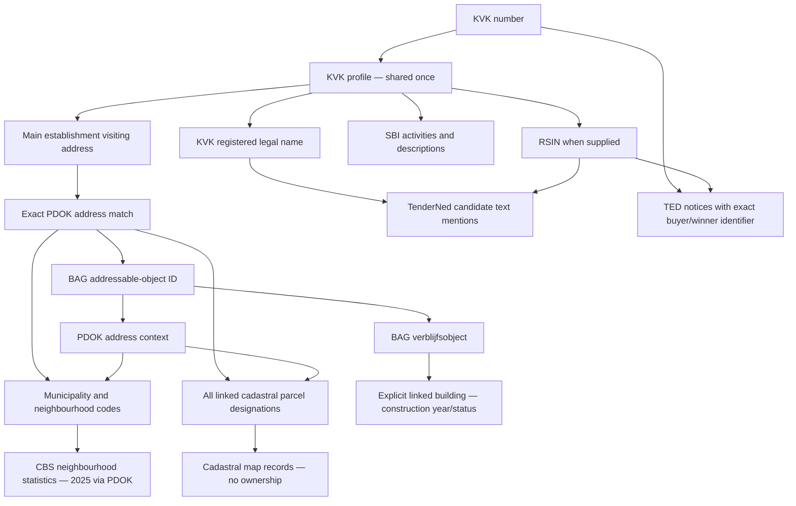

# Dutch identifier graph — implementation and verification

This extends the KOOP/RDW/RVO release with links between existing sources, six PDOK operations, two TenderNed search contracts, and a new TED source with KVK/RSIN notice searches. It adds ten execution contracts and upgrades both existing KVK profile aliases to expose observed identifiers. No ownership, subsidy receipt or eligibility is inferred from an address or procurement notice.

## Production status

Published and verified on 11 September 2026: all 12 affected contracts are active (10 additions and two KVK profile upgrades). The public directory lists 28 providers, including TED. Production-catalog natural-language checks passed with no rejected contracts. The app deployment is `6aa3d8d7efea999106a5a7de`; the Gateway image is `deployment-01M2814SD89SZKCPQNJMMJARTP`. Applied migrations are `20260911103924_gateway_v2_optional_output_read.sql` and `20260911104953_dutch_identifier_links.sql`, mirrored in the App repository.

## Enabled graph

An addressable-object ID, BAG nummeraanduiding, BAG pand ID, PDOK feature UUID, cadastral designation and apartment-right designation remain separate. A company visiting address describes its registered location; it does not establish that the company owns the building or land.

## Execution contracts

| Capability | Starting fact | Returned evidence |
|---|---|---|
| `company.registry-profile` / `company_registry.lookup` | KVK number | Existing profile plus RSIN, registered legal name, SBI activity records, main establishment number and address records |
| `company.registered-address-context` | KVK main-establishment address array | Exact postcode, house number, letter and addition match; BAG IDs, locality and linked parcel designations |
| `location.bag-address-context` | BAG addressable-object ID | Source-linked address and administrative context |
| `building.bag-unit` | BAG addressable-object ID | Exact verblijfsobject record; explicit building links |
| `building.bag-building` | Single canonical building link | BAG pand ID, construction year, use and status |
| `area.cbs-neighbourhood-2025` | CBS neighbourhood code | 2025 neighbourhood aggregates, labelled with source and period |
| `property.linked-parcels` | Array of 1–25 linked designations | Exact cadastral map records in one request; preserve multiple parcels |
| `procurement.company-name-mentions` | KVK registered legal name | One TenderNed text-search page; candidate mentions |
| `procurement.rsin-mentions` | RSIN | One TenderNed text-search page; candidate mentions |
| `procurement.ted-kvk-notices` / `procurement.ted-rsin-notices` | KVK number / RSIN | TED notice page with exact numeric match in buyer or winner identifiers; original role fields preserved |

TED uses the official anonymous `POST /v3/notices/search` behind the Apiosk read operation. Each page contains up to 20 notices. The adapter rejects timeouts and returned notices lacking the requested identifier. A match does not confirm the identifier scheme, jurisdiction or legal entity; historic notices and corrections remain possible. Source notice links are included. The direct endpoint supports explicit page selection up to the 15,000-notice page-number ceiling; automatic multi-page purchasing is not enabled.

Optional outputs are explicit contract metadata. Missing RSINs or optional location fields stay missing while validated available facts remain usable. A dependent step whose required identifier was not returned is skipped without dispatch; other branches continue. Existing contracts retain their prior strict output behavior. Grounded lookups are considered before unresolved name-search alternatives in the bounded resolver.

## What remains outside the verified graph

| Desired branch | Current boundary / next requirement |
|---|---|
| BAG → individual WOZ value | No supported anonymous national value-query integration was established. Public website access and CBS neighbourhood averages do not establish a property-level API. Select an authorized/licensed route and validate BAG-to-WOZ-object matching and valuation dates. |
| BAG → EP-Online energy label | Requires EP-Online access/API key and verification of the BAG object type, multiple labels and registration dates. No energy label is synthesized from building age or neighbourhood data. |
| BAG → DSO zoning/environment | The official DSO services require access configuration and location/document matching. Implement the selected service and verify current document versions and spatial scope before claiming applicable rules. |
| Parcel → BRK ownership | Open cadastral map geometry/designations are available; ownership and rights require an appropriate Kadaster product and authorization. BRK Bevragen is currently limited to eligible government organizations; commercial integration requires a suitable alternative product. |
| Procurement → company subsidy receipts | A procurement award is not a subsidy. The implemented RVO API contains scheme descriptions, including historical ones, not a verified company-level awards ledger. No RSIN-to-recipient join is enabled without a recipient dataset. |
| SBI → RVO eligibility | SBI may help formulate discovery, but code-version and policy rules require validation. RVO remains first-page keyword discovery, not eligibility or complete subsidy coverage. |
| Broad environmental data | Address centroids and locality identifiers are retained. Each environmental dataset still needs its own spatial/temporal contract and validated measurements. |

## Verification and billing

- Seven anonymous production-egress adapter probes passed: exact address, BAG address, BAG unit, linked building, CBS neighbourhood, linked parcels and TED identifiers.
- A live local chain followed one previously observed KVK visiting address through PDOK; every request validated the returned identifier. KVK itself was a stored real-source fixture, not a fresh paid call.
- The durable engine completed a ten-step graph with **one approval and one KVK lookup**, preserving saved results and making **zero extra calls on replay**. PDOK/TED were live; KVK/TenderNed/model/billing were fixtures in this test.
- A missing-RSIN test skipped both RSIN-dependent searches and completed the other eight calls. Missing optional apartment-right data did not discard valid BAG/neighbourhood facts.
- Natural-language model checks produced six-step location, two-step BAG-to-CBS and five-step procurement plans using the configured model and a read-only catalog snapshot.
- Request-encoding tests exercise the legacy `/execute` array serialization boundary. Adapter tests reject mismatched IDs, ignored filters, incomplete pages, unsupported building links and incorrect address suffixes. Workspace, durable regression and targeted app tests cover existing behavior.
- The tested full ten-step quote is **565,219 micro-USD ($0.565219)** at the current tariffs. Each newly added source call is **$0.054348 including the Apiosk fee**. Upstream public reads are anonymous; these are Apiosk integration/execution charges. There was no production balance debit during verification.

Evidence is retained under ignored `output/dutch-links-20260911/`. Source fixtures and tests are stored under `tests/fixtures/dutch-links/` and the new test/script files. Gateway executor changes are inside the independent `legacy-executor` Git submodule; no Git commit/push was requested.

## Official references

- [PDOK APIs and datasets](https://api.pdok.nl/) and [CBS Wijken en Buurten](https://www.pdok.nl/introductie/-/article/cbs-wijken-en-buurten)
- [TED Search API](https://docs.ted.europa.eu/api/latest/search.html) and [official schema](https://api.ted.europa.eu/api-v3.yaml)
- [EP-Online access manual](https://www.rvo.nl/sites/default/files/2025-02/handleiding-ep-online-opvragen-van-bestanden.pdf)
- [DSO available services](https://developer.omgevingswet.overheid.nl/api-register/beschikbare-api-services/)
- [Kadaster BRK Bevragen](https://www.kadaster.nl/zakelijk/producten/eigendom/brk-bevragen), [Kadaster custom API products](https://www.kadaster.nl/zakelijk/datasets/maatwerk-api-s-kadaster)
- [WOZ national provision](https://www.waarderingskamer.nl/voor-gemeenten/gegevensbeheer/lv-woz)
